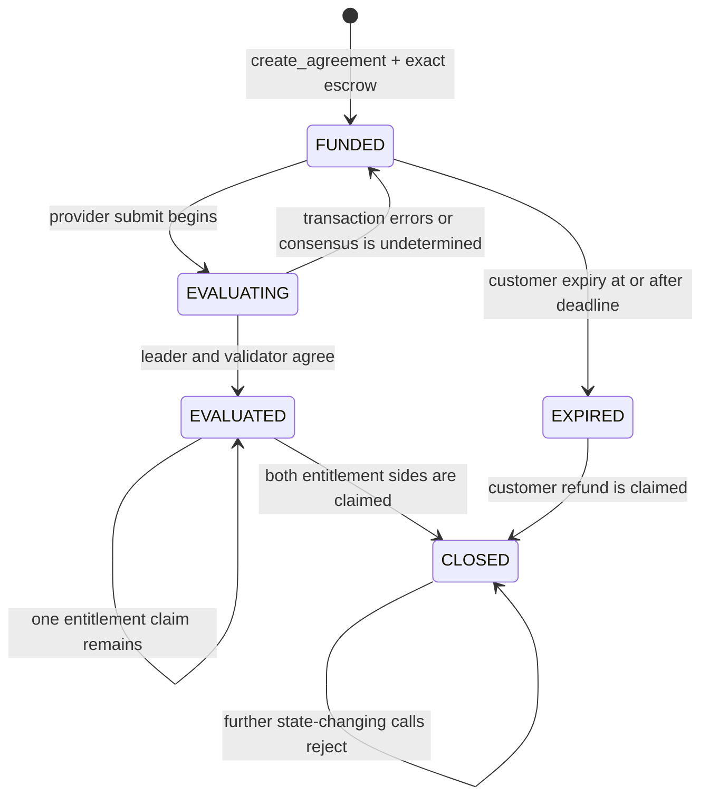
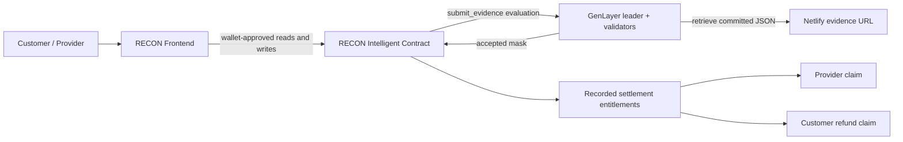

# RECON

**Verified work. Accountable payments.**

RECON is a GenLayer-powered service payment protocol. A customer defines one to five service requests, assigns a provider, and locks the exact native GEN escrow required by the agreement. The provider submits one Netlify-hosted JSON evidence document. GenLayer independently retrieves and evaluates the committed evidence against the customer-defined requirements, and the contract deterministically records payment and refund entitlements.

RECON evaluates submitted work. It does not independently prove every real-world event described by a provider.

## Why RECON?

Service payments often depend on one party's judgment after work has started. A provider may say that a deliverable is complete while a customer has no shared, pre-authorized standard against which to assess it.

RECON puts the requirements, reward and escrow onchain before evidence is submitted. The contract stores the customer-defined tasks and acceptance criteria, while GenLayer validators independently assess the submitted responses. The result is a bounded accepted-request mask; deterministic contract code uses that mask to calculate the provider's entitlement and the customer's unused escrow.

## How RECON Works

1. The customer creates an agreement with a nonzero provider, title, description, one to five request definitions, a reward per accepted request and a future deadline.
2. The customer sends exactly `request_count × reward_per_request` native GEN. The transaction sender becomes the customer; no customer address is supplied as an argument.
3. The agreement starts in `FUNDED`. Request IDs, tasks, acceptance criteria, provider, reward, escrow and deadline are stored without a public mutator.
4. Before the deadline, the assigned provider submits one HTTPS `*.netlify.app` URL and a lowercase SHA-256 commitment.
5. During `submit_evidence`, the leader and validator callback independently fetch the URL, verify the raw-byte commitment, parse the bounded JSON and evaluate each supplied response against the stored requirements.
6. Successful consensus records an accepted-request bitmask and moves the agreement to `EVALUATED`. There is no customer approval step.
7. The provider claims accepted-request rewards. The customer claims the unused escrow. These claims are separate operations.
8. If no successful evaluation is committed before the deadline, the customer can expire the funded agreement and claim the full escrow.

## Lifecycle

`EVALUATING` is included in the contract's status vocabulary as a temporary execution phase. It is not written as a durable status before consensus. The durable lifecycle is:



The submission condition is strict: the current contract time must be before the deadline. Expiry is allowed at or after the deadline, but only while the agreement is still `FUNDED`. GenLayer orders transactions for one Intelligent Contract, so a successful evaluation and expiry cannot both commit for the same agreement.

## GEN Settlement

For an agreement with `n` requests and reward `r`:

```text
total escrow                 = n × r
provider entitlement         = accepted request count × r
customer refund entitlement  = total escrow − provider entitlement
```

Illustrative example, not a live transaction:

- Three requests at 2 GEN each create a 6 GEN escrow.
- Two accepted requests give the provider 4 GEN.
- The customer can claim the remaining 2 GEN.

The contract calculates these values from the immutable reward and accepted mask. Evidence cannot set a payment amount, reward, score or wallet. Payment is not sent automatically by evaluation; the eligible party must call its claim method.

## Core Features

- Native GEN-funded agreements with exact payable escrow.
- One to five immutable service requests per agreement.
- Lowercase request identifiers with bounded text fields.
- One Netlify-hosted JSON evidence document per evaluation.
- Exact raw-response-byte SHA-256 verification.
- Independent leader and validator evidence retrieval and semantic assessment.
- A bounded per-request accepted mask.
- Deterministic provider payment and customer refund calculations.
- Provider payment claims and customer refund claims.
- Customer expiry after an unsuccessful funded agreement reaches its deadline.
- Public views for configuration, agreements, requests, evidence, expiry and claims.
- Typed TreeMap storage with no persistent `DynArray`.

## Smart Contract

The authoritative implementation is [`contracts/recon.py`](contracts/recon.py).

| Resource | Value |
| --- | --- |
| Network | GenLayer Studio Next |
| Chain ID | `61997` |
| RPC | `https://studio-next.genlayer.com/api` |
| Active contract | `0x1e01dCfaaCd4D7EbE5a6Ff3249Bff2331e546463` |
| Runner | `py-genlayer:5jycge4q8k23462jtb0b9fyey1s9qz928sz2nbrd9mg4sxqg2qng` |
| Local source SHA-256 | `afdf818576c63ab62dc0f6fbea816e9fd0eab5ba3c2c6a55b1bce159aeb77142` |
| Source size | 33,847 UTF-8 bytes |

The nondeterministic evaluation uses the Studio Next-supported `gl.vm.run_nondet(leader_fn, validator_fn)` entrypoint. The validator does not merely validate the leader's shape: it independently repeats retrieval, hashing, parsing and evaluation, and consensus requires equal bounded `accepted_mask` and `present_mask` values.

Persistent fields are typed scalar values and `gl.storage.TreeMap` instances. Requests are keyed by agreement and slot, with a separate agreement/request-ID lookup. There is no persistent `DynArray`.

### Public interface

Read methods:

- `get_config()`
- `get_agreement_count()`
- `get_agreement(agreement_id)`
- `get_status(agreement_id)`
- `get_expiry_status(agreement_id)`
- `get_request(agreement_id, slot)`
- `get_request_by_id(agreement_id, request_id)`
- `get_evidence(agreement_id)`
- `get_claim_status(agreement_id)`

Write methods:

- `create_agreement(provider, title, description, requests, reward_per_request, deadline)` — payable; the exact value must equal the request count multiplied by the reward.
- `submit_evidence(agreement_id, evidence_url, evidence_sha256)` — assigned-provider only; evaluates and records the accepted mask.
- `expire_agreement(agreement_id)` — customer only; available from `FUNDED` at or after the deadline.
- `claim_provider_payment(agreement_id)` — assigned-provider only; available from `EVALUATED`.
- `claim_customer_refund(agreement_id)` — customer only; available from `EVALUATED` or `EXPIRED`.

## Evidence Verification

The committed evidence must be a UTF-8 JSON object with exactly `agreement_id` and `responses`. Each response object must contain exactly `request_id` and `response`.

```json
{
  "agreement_id": 1,
  "responses": [
    {
      "request_id": "request_1",
      "response": "Example completed work."
    }
  ]
}
```

The contract requires an HTTPS URL hosted below a `*.netlify.app` hostname. It rejects credentials, ports, fragments, backslashes, whitespace, malformed hosts, non-2xx responses, redirects when a different final URL is exposed, bodies over 8,192 bytes, invalid UTF-8, duplicate JSON keys, non-standard JSON constants, unknown fields, unknown or duplicate request IDs, invalid agreement IDs and responses over 2,048 characters. Missing registered responses are not invented and cannot receive an accepted bit.

The frontend can fetch the URL server-side and generate the lowercase SHA-256 commitment from the exact response bytes. This is a convenience check before submission. The contract independently retrieves and verifies the evidence again during GenLayer evaluation.

## Application Architecture



The frontend is not an alternate settlement engine. It reads the contract, prepares typed calls, displays accepted-state data and opens Transaction Kit for wallet approval. The contract remains authoritative for roles, lifecycle, evidence commitment and payment amounts.

## Frontend

The frontend is a React and TanStack Start/Router application written in TypeScript. It uses Vite, Tailwind CSS, the GenLayer JavaScript SDK, Transaction Kit RC2, Radix UI primitives and Bun.

The current integration includes:

- Injected EIP-1193 wallet connection and Studio Next chain switching.
- Contract-backed agreement exploration and dashboard views.
- Payable agreement creation with exact bigint escrow calculation.
- Provider evidence verification and automatic raw-byte SHA-256 generation.
- Centered Transaction Kit review and hold-to-confirm flow.
- Real evidence submission, expiry, provider claim and customer refund calls.
- Accepted versus finalized transaction status handling.

Key versions are pinned in [`frontend/package.json`](frontend/package.json), including `genlayer-js@2.0.0-rc.1`, `@genlayer/transaction-kit@0.1.0-rc.2` and `@genlayer/transaction-kit-react@0.1.0-rc.2`.

## Local Development

```bash
cd frontend
bun install
bun run dev
```

The local server uses the port configured by the frontend (`http://localhost:3000`). An injected EIP-1193 wallet is required for write actions and must be connected to Studio Next.

The only documented frontend environment variable is optional:

```bash
VITE_GENLAYER_RPC_URL=https://studio-next.genlayer.com/api
```

The contract address is centralized in `frontend/src/lib/genlayer/network.ts`; there is no contract-address environment fallback.

Run validation from `frontend/`:

```bash
bun run typecheck
bun run lint
bun run test
bun run build
```

Run the contract host security suite from the repository root:

```bash
PYTEST_DISABLE_PLUGIN_AUTOLOAD=1 python3 -m pytest -q
genvm-lint check contracts/recon.py
```

Host tests and lint do not prove full GenVM consensus or native GEN child-transfer delivery.

## Deployment and Links

- [RECON GitHub repository](https://github.com/jason4185/recon)
- [GenLayer documentation](https://docs.genlayer.com/)
- [GenLayer Studio Explorer](https://explorer-studio-dev.genlayer.com/)

The active contract is deployed on Studio Next at `0x1e01dCfaaCd4D7EbE5a6Ff3249Bff2331e546463`. No production frontend URL is claimed here.

## Security and Limitations

- Netlify evidence is provider-submitted. A valid commitment proves which bytes were evaluated, not that the claimed service occurred or that the provider authored the document.
- GenLayer evaluates submitted responses against the stored requirements; it does not independently establish every external real-world fact.
- Evidence can contain instructions or claims, but the evaluator prompt treats it as untrusted and deterministic contract code ignores provider-declared payment fields.
- Native GEN payouts use asynchronous external messages. A finalized parent claim transaction does not alone prove that the recipient wallet received the child transfer.
- The V1 contract has no authenticated child-receipt callback or safe retry mechanism for an uncertain downstream transfer. Failed-transfer recovery must be verified in Studio Next and must not be assumed.
- Agreement closure records claim state; it is not an independent proof of recipient balance delivery.
- Internal adversarial tests cover source-level validation and accounting behavior. They are not an external audit or production-network security certification.

See the detailed [contract specification](docs/RECON_V1.md), [lifecycle analysis](docs/RECON_LIFECYCLE.md), [security audit](docs/RECON_SECURITY_AUDIT.md), [payout safety notes](docs/RECON_PAYOUT_SAFETY.md), and [retired deployment recovery record](docs/RECON_OLD_DEPLOYMENT_RECOVERY.md).

## Repository Structure

```text
recon/
├── contracts/
│   └── recon.py
├── frontend/
│   ├── src/
│   ├── package.json
│   └── README.md
├── tests/
│   └── test_recon_security.py
├── docs/
│   ├── RECON_V1.md
│   ├── RECON_LIFECYCLE.md
│   ├── RECON_SECURITY_AUDIT.md
│   ├── RECON_PAYOUT_SAFETY.md
│   └── RECON_OLD_DEPLOYMENT_RECOVERY.md
├── README.md
└── .gitignore
```

The retired deployment recovery document is historical information only and is not imported by the frontend runtime.
