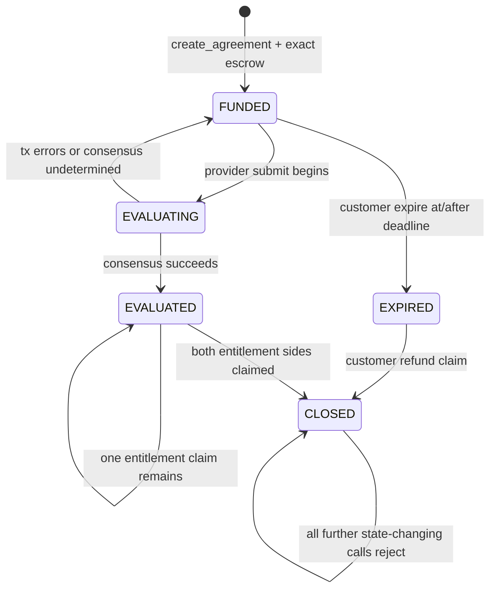

# RECON V1 Lifecycle

## Persistent states

| State | Meaning | Allowed actors | Advance | Escrow entitlement |
| --- | --- | --- | --- | --- |
| `FUNDED` | Exact native GEN escrow is reserved and no evaluation has committed. | Provider: submit before deadline. Customer: expire at/after deadline. Anyone: views. | Successful consensus → `EVALUATED`; customer expiry → `EXPIRED`. | No claim is available yet. |
| `EVALUATING` | Temporary execution phase while the provider submission is running nondeterministic consensus; it is never a durable storage value. | No independent public operation executes concurrently for the same contract. | Successful transaction writes `EVALUATED`; failed/reverted/undetermined transaction leaves the committed state at `FUNDED`. | No claim. |
| `EVALUATED` | One accepted mask and evidence commitment are finalized in contract state. | Provider: accepted entitlement claim. Customer: unused escrow claim. | After both entitlement sides are marked claimed → `CLOSED`. | Provider = accepted bits × reward; customer = escrow − provider. |
| `EXPIRED` | Deadline passed without a successful committed evaluation. Provider entitlement is disabled. | Customer: full escrow claim. Anyone: views. | Customer claim → `CLOSED`. | Customer = full original escrow; provider = zero. |
| `CLOSED` | Both sides’ claim records are terminal. | Anyone: views only. | None. | The contract’s accounting says the full escrow is claimed; actual external-recipient receipt remains a GenLayer child-message concern. |

`EVALUATING` is deliberately distinguished from persistent business state. The write method does not write a pre-consensus lock. GenLayer orders transactions to one Intelligent Contract, so an expiry cannot execute concurrently with the in-flight submission; the first durable write after consensus is `EVALUATED`. An undetermined or contract-error evaluation therefore leaves the committed state at `FUNDED`. Host stubs can exercise this retry-friendly shape without modeling rollback.

## Transition table

| Current | Method / condition | Sender | Checks | Next state | Financial effect |
| --- | --- | --- | --- | --- | --- |
| none | `create_agreement` | customer from transaction sender | provider distinct/nonzero; 1–5 valid immutable requests; reward/deadline valid; `msg.value == n × reward` | `FUNDED` | Exact escrow enters agreement accounting. |
| `FUNDED` | `submit_evidence` (temporary `EVALUATING`) | assigned provider | URL/hash valid; `now < deadline`; leader and independent validator agree | `EVALUATED` | No transfer. Accepted mask fixes both entitlements. |
| `FUNDED` | `submit_evidence` fails | assigned provider | invalid fetch/hash/JSON/consensus/error | `FUNDED` after transaction failure | No settlement state is committed; retry is possible before deadline. |
| `FUNDED` | `expire_agreement` and `now >= deadline` | customer | status still `FUNDED` | `EXPIRED` | Provider side is marked as zero entitlement; full refund becomes available to customer. |
| `EVALUATED` | `claim_provider_payment` | assigned provider | provider side not already claimed; amount and total ≤ escrow | `EVALUATED` or `CLOSED` | Emits accepted-request amount; then records provider claim. |
| `EVALUATED` | `claim_customer_refund` | customer | customer side not already claimed; amount and total ≤ escrow | `EVALUATED` or `CLOSED` | Emits unused escrow; then records customer claim. |
| `EXPIRED` | `claim_customer_refund` | customer | customer side not already claimed; total ≤ escrow | `CLOSED` | Emits full escrow; then records refund claim. |
| `EVALUATED`/`EXPIRED` | repeated/incorrect claim | wrong role or already claimed | rejected | unchanged | No transfer. |
| `EVALUATED`/`EXPIRED` | `expire_agreement` | any | status is not `FUNDED` | rejected | No transfer. |
| `CLOSED` | any claim/expiry/submission | any | terminal state gate | rejected | No transfer. |

## Boundary and race analysis

The submission condition is strict (`now < deadline`); expiry uses inclusive boundary (`now >= deadline`). GenLayer orders transactions to one Intelligent Contract sequentially. Therefore, two competing transactions cannot both commit contradictory transitions:

1. If submission commits first, status is `EVALUATED` and expiry rejects.
2. If expiry commits first at or after the boundary, status is `EXPIRED` and submission rejects.
3. If evidence retrieval or consensus fails, the failed transaction does not establish `EVALUATED`; the customer remains able to use expiry once the failed transaction resolves.
4. A second provider submission sees `EVALUATED` or `EXPIRED` and rejects.
5. Claims in either order consume only the one agreement’s entitlement. A zero-entitlement side is pre-marked claimed, so no zero-value transfer is required.

An evaluation transaction can be pending at the protocol layer and delay the next queued operation, but that is not a durable `EVALUATING` storage state. Final Studio testing must verify the queue behavior and transaction error/undetermined rollback.

## Mermaid diagram

## Recovery matrix

| Condition | Recovery route |
| --- | --- |
| Invalid evidence or failed consensus before deadline | Provider submits again; no entitlement exists until success. |
| No successful evaluation after deadline | Customer calls `expire_agreement`, then `claim_customer_refund`. |
| Provider claim synchronous emission error | Claim state is not written because emission occurs first; provider retries. |
| Customer refund synchronous emission error | Claim state is not written; customer retries. |
| External child transfer fails after parent finalization | No verified contract-level recovery or safe retry exists in V1; Studio verification is a deployment blocker. |
| Agreement has been closed | No public recovery or treasury sweep exists. A closed agreement assumes both external messages were accepted by the runtime, but the contract cannot prove recipient receipt. |
